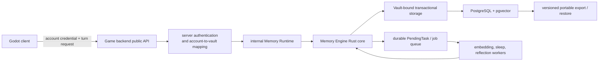
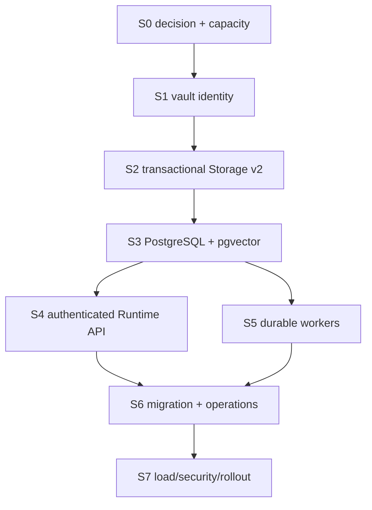

# Server-scale Memory Runtime

## Related pages

- [Research: Server Memory Runtime](../research/server-memory-runtime-2026-08-01.md)
  - evidence and rejected alternatives behind this plan.
- [Strategy](../foundation/strategy.md) - stable product principles.
- [Architecture](../foundation/architecture.md) - current implementation and
  accepted server-mode boundary.
- [Contracts](../foundation/contracts.md) - current contracts and planned
  storage/identity additions.
- [Roadmap](roadmap.md) - cross-project task status.
- [Chibigochi LLM Bridge](../integration/chibigochi-llm-bridge.md) - current
  Godot bridge and the future server boundary.

## Status and purpose

Status: **accepted strategic plan; S1 reference contracts are in progress**.

This document is the implementation authority for taking Memory Engine from a
single-process/local storage library to the centralized service required by a
Google Play release with thousands of players. It deliberately runs beside the
cognitive v0.5-v0.7 roadmap: scale work must not rewrite Session, Archive,
Core, reflection or the hypothesis graph into host-specific logic.

The production gate is not “one thousand threads passed”. The gate is that
multiple authenticated players and multiple server replicas can use the same
service without cross-vault disclosure, lost turns, divergent state or an
unrecoverable memory database.

## Strategic decision

We keep one Rust cognitive core and add a server deployment form around it.

Godot stays a thin product client. It owns scenes, local responsiveness and
game UI; it does not hold database credentials, choose another player's scope,
or reproduce memory policy. The server authenticates the principal, derives a
logical vault and calls the same core used by local hosts.

For the first production version, Memory Runtime is a logical internal
component of the game backend, not a second public Internet API. The game
backend owns external Play/guest authentication and passes an authorized
`VaultContext` to the runtime. The boundary may later move behind a private
service-to-service API if independent scaling or failure isolation is measured
to require it; Godot and the cognitive core contract do not change.

`FileStorage` remains supported for development, tests, local/private use and
portable export. PostgreSQL becomes the operational source of truth only for
vaults assigned to the server backend. A vault has exactly one authoritative
backend at a time.

## Non-negotiable invariants

### Identity is not a query parameter

The server maintains `account_id -> vault_id` membership. A client request may
name a conversation/session and an idempotency key, but it cannot choose the
authoritative vault. The runtime creates `VaultStorage` only after
authentication and binds the vault internally for the lifetime of the
operation.

Every owned row, vector, task, graph edge and outbox event carries `vault_id`.
References use composite ownership keys so an archive in vault A cannot point
to a unit in vault B. PostgreSQL RLS provides a default-deny second boundary;
the application role is not the table owner. Pooled connections never retain a
session-global vault context: RLS context is set transaction-locally for every
work unit and an absent context fails closed.

The same rule applies above SQL: lock keys, caches, deduplication maps, metrics
labels and model/vector caches are either vault-qualified or contain no
player-owned data. A globally unique-looking record ID is not permission to
omit the vault from a cache or lock key.

### A memory operation has one commit boundary

The present method-by-method `Storage` trait cannot make a multi-record
read-modify-write operation atomic across replicas. Server work therefore
introduces a transaction-capable Storage v2 rather than disguising SQL behind
the current trait.

Short mutations within one vault serialize initially. Different vaults run in
parallel. Optimistic record revisions/idempotency prevent repeated requests
from applying the same effect twice. We only split the vault lock into finer
resources after telemetry proves it is a bottleneck.

### Provider work happens outside transactions

LLM and embedding calls never hold a database connection, row lock or vault
lease. The core commits durable intent, a worker performs external work, and a
new transaction revalidates the frozen input before applying the result. This
preserves the existing `PendingTask` philosophy and journal/recovery rules.

### Live turns are ordered and idempotent

Each incoming turn has a stable `client_request_id`; each accepted conversation
turn receives a monotonic server sequence. A duplicate returns the stored
result or resumes the same operation. Two same-session requests cannot commit
assistant/user events in reverse order merely because one provider call was
faster.

The mobile client persists the request ID until it receives a terminal server
acknowledgement. A timeout or reconnect retries that ID; it does not fabricate a
new memory event or treat unacknowledged local state as durably remembered.

### Vectors remain derived and optional

The server may compute embeddings locally with the configured multilingual
model and store them in pgvector. Exact per-vault cosine search is the first
implementation. Vector absence cannot break structural Stage 1 recall, and
vector rows can always be rebuilt from MemoryUnit text/provenance.

### Human control survives the database

Server records use the same versioned domain schemas as the library. A
deterministic export produces a complete, human-inspectable vault bundle with
manifest, records, provenance and checksums; import round-trips it without
semantic loss. Account deletion covers primary rows, vectors, tasks and queued
exports under an auditable retention policy.

## Target data and service boundaries

The first relational model uses pooled tables keyed by `vault_id`:

- accounts, external identities, vaults and memberships;
- conversations/sessions, events and archived event coverage;
- archives and atomic memory units;
- Core categories/facts, candidates and hypothesis nodes/evidence/relations;
- PendingTasks, sleep/reflection runs and recovery operations;
- embeddings keyed by vault, unit, model and dimension;
- idempotent turn operations and durable outbox/jobs;
- schema/migration state per vault and for the service.

Domain payloads may use JSONB where that preserves evolving versioned records,
but ownership, state, revision, timestamps and hot lookup fields are explicit
indexed columns. This is not one opaque JSON document per player and not one
PostgreSQL partition per player.

The Memory Runtime API is a server integration surface, not a second memory
engine. It performs authentication, request validation, idempotency, quotas,
transaction setup and metrics; all cognitive decisions stay in the Rust core.

## Implementation phases

The phases are ordered by failure containment. Later cognitive work may
continue when it is storage-agnostic, but a Google Play production rollout is
blocked until S7.

### S0 — Decision and measurable launch envelope

**Outcome:** the team agrees on the deployment boundary before code forks into
local and server memory policies.

This document, the research note and the foundation updates close the
architecture part of S0. The product owner still supplies forecast inputs:
stored accounts, simultaneous active users, normal/peak turns per second,
retention and regions. Until then the research envelope is explicitly
provisional.

**Exit gate:** architecture review accepts one-vault authority, server-derived
identity, PostgreSQL/pgvector, no dual-write and one-region-first. Product
capacity assumptions are written and versioned.

#### Planning envelope v1 (2026-08-01)

The first implementation is sized against a deliberately conservative launch
envelope rather than the old local “1,000 sessions” stress result:

| Dimension | Planning baseline | S7 acceptance load |
|---|---:|---:|
| Stored accounts after the first launch year | 100,000 | data set at or above 100,000 |
| Peak simultaneously active players | 1,000 | 2,000 |
| Sustained complete turns per second | 40 | 80 |
| Five-minute burst turns per second | 150 | 300 |
| Launch geography | one EEA region | same region, multi-zone |
| Memory-service latency, excluding provider generation | p95 <= 250 ms, p99 <= 750 ms | measured on the full workload |
| Turn admission/idempotency latency | p95 <= 50 ms | measured under duplicate/concurrent load |
| Recovery point / recovery time | RPO <= 5 minutes / RTO <= 60 minutes | restore drill, not a paper claim |

Vault domain memory is retained until owner deletion or an explicit product
retention decision; the engine does not silently age-delete human memory to
meet a storage target. Idempotency operation results have a provisional
30-day retention, text-free operational telemetry 14 days, and backup deletion
propagation at most 35 days. These three retention values are engineering
defaults pending the product privacy policy and must not be presented publicly
before owner/legal review.

This baseline is sufficient to design identity keys, transaction boundaries,
connection budgets and S7 workload geometry. It is not a sales forecast or a
capacity claim. Before infrastructure purchase or public launch, measured
closed-test behavior replaces stored-account, concurrency and turn-rate
assumptions; the owner must explicitly approve retention, region and RPO/RTO.
The capacity-neutral S1 contract slice may proceed against this baseline;
database sizing, paid infrastructure and launch acceptance may not treat S0 as
closed until those owner decisions are recorded.

### S1 — Vault identity and request contracts

**Outcome:** no core operation can run in server mode without an authenticated,
explicit vault binding, and retries are safe.

Introduce opaque `VaultId`/`AccountId`, external identity linking, a vault-bound
engine/storage handle, `client_request_id`, turn operation state and monotonic
session sequencing. Remove all server-path fallbacks to `local_user` or a
default scope. Add cross-vault negative fixtures before any database adapter.
Define guest-account creation and verified Play Games linking without merging
memory automatically.

**Exit gate:** forged vault IDs, missing identity, replayed requests,
cross-vault references and out-of-order same-session completion all fail or
resolve deterministically in tests. Local `FileStorage` APIs remain compatible
through an explicit local vault binding.

**Implemented reference slice (2026-08-01):** the Rust core now has validated
opaque `AccountId`, `VaultId` and `ClientRequestId` types, authenticated
principal + active membership derivation of an internal `VaultContext`, and a
manual-review result when a verified Play Games identity is already attached
to another account. No API accepts a missing identity or falls back to
`local_user`.

`VaultTurnLedger` assigns a server-monotonic sequence inside each session,
deduplicates `client_request_id` inside the bound vault, stores the terminal
result reference/digest and refuses to commit sequence N+1 before N. Its
operation ID includes the vault even when two players reuse the same request
ID. `LocalVaultHandle` persists this ledger atomically beside an explicitly
vault-rooted `FileStorage` for restart and negative tests. It is a
single-process reference, not the production transactional backend promised by
S2/S3.

S1 is not closed yet: the public game API and mobile retry loop are S4 work;
verified Google credential exchange and a durable account/identity registry do
not exist yet; and production multi-replica atomicity waits for Storage v2.

### S2 — Transaction-capable Storage v2

**Outcome:** one domain transition is atomic and retryable independent of the
physical backend.

Inventory every current `Storage` call chain and classify it as read-only,
single-record, transactional mutation or durable workflow. Introduce a
transaction/work-unit API with point queries and optimistic revisions. Move
correctness-critical in-memory counters/checkpoints to durable records; mark
pure telemetry as lossy so it cannot silently influence ranking differently
across replicas. Keep the current trait as an adapter during migration rather
than breaking all hosts at once.

**Exit gate:** ingest, sleep completion, reflection apply/review, forgetting,
hypothesis migration and task transitions pass fault-injection tests on an
in-memory transactional reference. No transaction crosses an LLM/embed call.
The compatibility/release impact is recorded under the pre-1.0 SemVer policy.

### S3 — PostgreSQLVaultStorage and pgvector

**Outcome:** two processes can safely operate on different vaults and contend
correctly on one vault.

Implement migrations, pooled connections, vault-keyed tables, composite
foreign keys, non-owner runtime roles and RLS. Use short per-vault row locks for
mutations and bounded retries for serialization/deadlock failures. Implement
exact vector search filtered by vault/model, vector rebuild state and deletion.
Add point/indexed reads for recall, tasks and graph records; no production hot
path scans every player's archive. RLS tests run through the actual pool and
prove transaction-local context cannot bleed into the next borrower.

**Exit gate:** multi-process integration tests prove atomic transitions,
read-your-writes, cross-vault denial, crash recovery, model mismatch handling
and vector/non-vector parity. Query plans and pool usage are captured for the
provisional workload. Approximate vector indexes remain absent unless these
measurements justify them.

### S4 — Memory Runtime service

**Outcome:** Godot talks to an authenticated server surface, not a filesystem
or raw storage adapter.

Add the logical runtime boundary inside the game backend. The backend
validates/exchanges Play Games server auth codes, maps them to internal
accounts, issues server sessions and derives vault membership; the Memory
Runtime accepts only the resulting authorized `VaultContext`. The public game
API exposes bounded turn/context and account export/delete operations, while
health/admin stay private. Add quotas, request-size limits, timeouts and
text-free structured diagnostics. Play Integrity may add risk signals and
request binding; it does not choose the account. Network retry uses the
original idempotency key until the server returns a terminal result.

**Exit gate:** end-to-end Godot test covers new account, restart, reconnect,
account link, duplicate turn, concurrent turn, unauthorized vault attempt and
clean deletion. Memory text and embeddings never enter routine logs.

### S5 — Durable background execution

**Outcome:** sleep, reflection and embedding survive replica restart and
backpressure without blocking live chat.

Use PostgreSQL-backed jobs/outbox with leases, attempts, next-run time and
idempotent completion. Workers claim batches with `SKIP LOCKED`, execute local
embeddings or host-selected LLM calls outside transactions, then submit through
the same revalidation path. Separate interactive and maintenance concurrency;
enforce per-vault and global quotas so a backlog cannot exhaust the database or
provider.

The embedding model is loaded and warmed once per worker process, not once per
vault or request. Compatible jobs are batched; readiness does not go healthy
until the configured model/dimension can answer. Model changes create a new
versioned index scope and backfill queue while structural recall remains live.

**Exit gate:** kill/restart tests show no lost or duplicate side effects;
poison tasks become visible/manual rather than retrying forever; fresh units
become searchable within the defined service-level objective; chat remains
available while maintenance is degraded; cold-start/model-rollout behavior is
measured rather than hidden in the first player's request.

### S6 — Portability, migration and operations

**Outcome:** production storage remains owned, inspectable and recoverable.

Specify and implement versioned vault export/import with checksums and round-
trip tests against `FileStorage`. Build one-authority migration: snapshot local
vault, validate, import, switch routing once, verify, retain rollback snapshot;
never keep files and PostgreSQL as equal writers. Add point-in-time recovery,
restore drills, schema rollout/rollback procedure, per-vault deletion and
account-link conflict review. Orphaned/shared `local_user` data is never merged
automatically.

The product also provides a discoverable in-app deletion path and an external
web deletion resource, and keeps Play Console Data safety disclosures/privacy
policy consistent with actual memory collection, retention, providers and
deletion behavior.

**Exit gate:** sampled exports are human-readable; import/export hashes and
record counts agree; a clean database can be restored within the chosen RPO/
RTO; one test vault migrates and rolls back without divergence; account
deletion removes all associated vault data subject only to explicitly disclosed
retention.

### S7 — Production acceptance and gradual rollout

**Outcome:** capacity, isolation and recovery are demonstrated on the whole
product path.

Build a workload from measured Chibigochi behavior: complete turns plus a
realistic mix of sleep/reflection/vector jobs, hot and cold vaults, duplicate
requests, same-vault bursts and provider stalls. Run at twice the expected
launch peak. Measure p50/p95/p99 core/service latency, DB pool wait, vault lock
wait, queue age/depth, retry/error rate, vector latency, database growth and
cross-vault violations. Start service concurrency low and tune against the
database connection budget.

Roll out through internal vaults, a small opted-in cohort, staged percentages
and finally general availability. Every stage has automatic rollback gates and
one authoritative backend per vault.

**Exit gate:** zero cross-vault reads/writes, no lost/duplicated committed
turns, acceptance latency/error objectives met, backup restore and export/
delete drills passed, rollback exercised, and operational dashboards/alerts
owned by the team.

## Dependency and rollout order

S1 and the cross-vault test harness must precede production data work. S4 and
S5 can proceed in parallel after S3 contracts stabilize. S6 must exist before
real player migration; S7 is the launch gate.

The v0.6/v0.7 cognitive graph can continue against Storage v2 interfaces, but
new persisted structures must include vault ownership and transactional
semantics from the start. We do not finish sophisticated reflection on a
backend that cannot keep two players apart.

## Risks and designed responses

| Risk | Designed response |
|---|---|
| Silent shared/default identity | No default server vault; authenticated mapping and cross-vault tests at every layer. |
| Same-player write races | Short vault mutation serialization, record revisions, idempotency and turn sequence. |
| Database connection storm | Global connection budget, small pools, bounded service concurrency and backpressure. |
| LLM latency holds resources | Durable task boundary; no provider call inside DB transaction. |
| Approximate vector misses | Exact per-vault search first; benchmark before ANN. |
| Two memories diverge during migration | One authority per vault; snapshot/import/cutover, not continuous dual-write. |
| Database becomes a black box | Versioned deterministic export/import, provenance and restore drills are acceptance requirements. |
| New graph database multiplies consistency problems | Store the current hypothesis graph relationally until measured traversal requires otherwise. |
| Multi-region conflicts | One region/one assigned primary per vault first; shard placement later. |

## Explicit non-goals for the first server release

- active-active multi-region writes;
- one database/schema/partition per player;
- a separate vector database or graph database;
- Redis or Kafka as mandatory infrastructure;
- trusting a client-provided player/vault identifier;
- changing the three memory layers or making vectors mandatory;
- moving LLM/provider policy into Godot;
- publishing throughput claims before reproducible whole-path acceptance.
