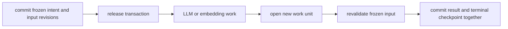

# Storage v2 Work-Unit Inventory

## Purpose

Status: **S2 inventory complete; S2.A and S2.B externally accepted; S2.C
Sleep-start implemented with internal acceptance pending; S2 exit gate open**.

This page is the migration ledger between the method-by-method local `Storage`
trait and the vault-bound transactional storage required by the server runtime.
It prevents a PostgreSQL adapter from preserving today’s multi-record races
behind different method names. Every state-changing engine flow must receive an
explicit transaction boundary or an explicit durable-workflow boundary before
S2 can close.

## Related pages

- [Server-scale Memory Runtime](server-scale-memory-runtime.md) - normative
  S0-S7 plan and production invariants.
- [Roadmap](roadmap.md) - phase status and release gates.
- [Architecture](../foundation/architecture.md) - current local and server
  deployment forms.
- [Contracts](../foundation/contracts.md) - versioned Storage v2 envelopes.
- [Strategy](../foundation/strategy.md) - one reusable cognitive core and human
  control over memory.

## The unit we are protecting

A transaction is not “all work performed for one chat turn”. It is the smallest
domain transition that must become visible as one fact. Long provider work is a
durable workflow composed of several such transactions:

This preserves the project’s existing distinction between deterministic Rust
policy and host/provider execution. Storage v2 does not create another memory
engine or another workflow orchestrator.

## Current call-chain inventory

| Domain path | Current records and state | Class | Required S2 boundary |
|---|---|---|---|
| Context package, ordinary recall, deep recall, graph export, candidate/task lists | Session, Core, Archive, MemoryUnit, vector and graph reads | Read-only query | Vault-bound point/index reads from one committed view; no mutation hidden in the query |
| Recall usage statistics | Replica-local deltas followed by Archive read/modify/write | Correctness-affecting mutation disguised as telemetry | Either durable atomic counters or explicitly lossy metrics removed from scoring; replica-local state may not alter ranking |
| Ingest | Event append, Session metadata and local Markdown projection | Transactional mutation | Event record and Session metadata commit together; human-readable projections are derived outside the source-of-truth commit |
| Core upsert/patch | Core category read/modify/write | Transactional mutation | Exact revision check and one category replacement in one work unit |
| Sleep Stage 1 | Session workflow claim, preliminary Archive, compression/unit tasks, initial SleepRun and immutable operation result | Durable workflow start | Frozen policy and selected source IDs, one active Session claim and all five workflow records commit as six atomic mutations; preliminary selection is not Complete archive coverage |
| Sleep pass submit/finish | SleepRun, PendingTask, Archive, MemoryUnits and Session coverage | Durable workflow continuation | Provider call outside storage; each submit revalidates the run/task/input revisions and atomically advances all affected records |
| Fidelity review | PendingTask, MemoryUnit and Archive fidelity projection | Durable workflow | Begin commits task/input identity; submit atomically applies review and terminal task state |
| Forgetting and remember-back | Review task, units, Archive projection and vector tombstone/rebuild intent | Durable workflow | Decision and domain state commit together; vector work remains derived and replayable |
| Reflection analyze/apply/review | Reflection state, task, operation journal, candidates/nodes/evidence, units, archives and optional Core promotion | Durable workflow | Existing frozen intent/recovery semantics become transactional commit steps; no partial candidate/Core/review transition |
| Hypothesis graph migration | Legacy candidates, nodes, evidence, manifest and journal operation | Durable migration workflow | Idempotent batches with frozen scope, exact source revisions and atomic checkpoint/output commit |
| Vector backfill/rebuild | Vector manifest/index rows, tombstones and embed tasks | Durable derived-index workflow | Task/scope state is durable; embedding is outside transactions; structural memory remains authoritative |
| Manifest and isolated task/run checkpoints | One versioned record when no related domain write exists | Atomic single-record mutation | Exact revision write; fold into a wider work unit whenever it represents the same transition |

The inventory’s important result is that `Storage::append_event` was never a
true single-record operation. `FileStorage` appends JSONL, then updates Session
metadata, then updates Markdown. The new server path treats only the event and
Session metadata as authoritative; Markdown is a projection and cannot make the
commit fail halfway.

## Implemented S2 foundation

`storage_v2.rs` now defines an additive, backend-independent boundary:

- a work unit is born from a validated, server-derived `VaultContext` and can
  address only `RecordKey { collection, record_id }`; callers cannot smuggle a
  second vault into a record key;
- every persisted value has a `VaultRecord` envelope with vault, payload schema,
  monotonic revision and timestamps;
- writes require `ExpectedRevision::Absent` or `Exact(n)`, and all observed
  revisions are checked again at commit;
- `WorkUnitIntent` provides operation identity, kind, stable request digest and
  start time; a committed `WorkUnitReceipt` makes a same-input replay return the
  original result while conflicting reuse fails closed;
- `execute_work_unit_with_retry` restarts the entire deterministic closure on
  optimistic conflict. Storage/provider failures are not silently retried as
  conflicts;
- the in-memory reference builds the complete next vault state and publishes it
  once. Operation-bound failpoints cover before apply, each staged mutation,
  receipt creation before publish, and publish before acknowledgement. Every
  pre-publish failure leaves no records/receipt; a lost acknowledgement is
  classified as `CommitOutcomeUnknown`, then the executor reopens the same
  operation and returns its committed receipt. A later caller replay returns
  that same result without another mutation.

The first migrated domain transition is `MemoryEngine::ingest_transactional`.
It derives a stable event ID from vault and operation identity, applies the same
event scoring policy as local ingest, and atomically creates the event record
and creates/updates Session metadata. Concurrent distinct operations against
one Session retry on revision conflict; a duplicate operation cannot increment
`event_count` twice.

The next migrated transition is transactional Core upsert/patch. It does not
fork Core policy: local Storage v1 and Storage v2 call one shared deterministic
fact-mutation policy. The server path replaces one category under an exact
record revision and commits a durable operation-result record beside it.
Keeping the result in the same transaction matters because `created` and the
returned fact depend on the state observed by the first attempt; a replay after
later reinforcement must return that original result, not recompute history.
New Core IDs are deterministic from vault and operation identity. Patch carries
the normalized category explicitly, so a server backend performs one point
mutation instead of scanning every category.

Committed-view Stage 1 recall is the other completed S2.B transition. Ranking,
selected-archive feedback and the exact result commit together, so replay
cannot increment counters twice or silently see a newer ranking. The Core and
recall slices passed independent source-level acceptance at `2bdc0ae` and
`7314833`, including concurrency, replay, vault isolation, phantom protection
and Storage v1/adapters regression checks.

S2.C has now started with transactional Sleep Stage 1. It reuses the existing
deterministic Stage 1 selection policy, uses server-controlled `received_at`
for the active-tail boundary and equal-weight selection, freezes the policy and
selected sources, and atomically commits the Session sleep claim, preliminary
Archive, two PendingTasks, initial
SleepRun and immutable operation result. Only one workflow may claim a Session
at a time. The preliminary Archive reserves work but does **not** add its
sources to Complete archive coverage; those events remain live until a future
finalize transaction validates provider output and commits completion. Eleven
focused tests cover selection/active-tail parity, hostile client timestamps,
coherent replay, one-active-claim concurrency, concurrent ingest, every one of
the six mutation edges, frozen-input tamper, operation reuse and vault
isolation, plus fail-closed incomplete coverage state and rejection of a
rewritten append-only event. Internal acceptance is still pending, so this is
not an accepted S2.C slice yet.

This is a reference and conformance surface, not the production backend.
`FileStorage` and `MemoryEngine::ingest` remain unchanged for existing local,
Python and Godot hosts. No host has been switched automatically, and PostgreSQL
does not begin until S2’s domain migration gate closes.

## Migration sequence from here

### S2.A — Foundation and ingest (logical reference accepted; host adapter pending)

The code boundary and in-memory reference exist. Ten deterministic tests cover
all logical pre-publish edges, automatic receipt reconciliation after a lost
commit acknowledgement, idempotent and conflicting replay, frozen-input tamper, concurrent same-session ingest,
optimistic rollback, operation-targeted failpoints, invalid-edge cleanup,
versioned serialization and vault isolation. An external source-level
acceptance of `af932a4` independently inspected and passed these assertions.
This closes the library-level logical reference gate. Before this subphase is
called host-ready, the built adapter that will actually call Storage v2 must
still verify the same public serialization and retry behavior.

### S2.B — Correctness state and small mutations

**Core and committed-view recall sub-slices externally accepted.** Transactional
upsert/patch now has frozen request digests, durable results, exact revision
checks, deterministic IDs, scope/vault isolation and the same logical
fault/replay contract as ingest. Seven tests cover same-category contention,
replay after later state change, reinforcement, scope isolation, point patch,
all pre-publish edges, lost acknowledgement and cross-vault separation.
Storage v1 and both existing host adapters remain unchanged. Independent
acceptance of `2bdc0ae` and `7314833` passed both focused suites, the shared
policy audit, workspace tests, clippy, documentation links and adapter
regression checks. This closes the S2.B logical-reference gate only.

The recall-statistics ambiguity is resolved as a design decision: Archive
`recall_count` and `last_recalled_at` are **correctness state**, because Stage 1
reads them to alter ranking and forgetting uses their archive-level proxy.
They are not allowed to remain replica-local on the server path and cannot be
downgraded to telemetry while those policies consume them.

**Committed-view Stage 1 recall is now implemented as the second S2.B
sub-slice.** `recall_transactional` ranks a vault-bound Archive snapshot with
the same Stage 1 policy as Storage v1, increments feedback on exactly the
selected entries and stores the exact `RecallResult` in one work unit. Replay
cannot count twice or return a newly recomputed rank. Snapshot collection reads
track membership and revisions, so an insert/delete/update during the operation
causes whole-unit retry instead of a phantom result. Eight tests cover every
pre-publish mutation edge, lost acknowledgement, tamper, replay, concurrent
feedback, cross-replica ranking visibility, phantom insertion and vault
isolation.

This reference intentionally supports Stage 1 only. A request carrying
`query_embedding` fails clearly until S2.D ports the vector scope/index; it
does not silently degrade a caller that explicitly requested Stage 2. The
in-memory reference scans one vault collection for conformance. S3 must replace
that with indexed Archive queries and prove query plans; this is not a
production scan approval. The next migration boundary is the rest of the S2.C
Sleep workflow, not an isolated manifest or coverage write.

### S2.C — Sleep, fidelity and forgetting

**Sleep-start implementation exists; internal acceptance pending.** Its short
begin transaction makes six changes visible together: Session workflow claim,
preliminary Archive, compression task, MemoryUnit task, initial SleepRun and
immutable replay result. It shares Stage 1 selection with Storage v1 and uses
server receive order for the active-tail partition and equal-weight truncation,
so untrusted client timestamps cannot move new turns or win a selection tie.
The Session keeps a separate pending-event reservation;
`archived_event_ids` and `archived_to` continue to mean coverage by Complete
archives only.

Next implement transactional pass submit, finalize and cancel/recovery. Each
continuation must revalidate the frozen workflow and record revisions, apply
task/run/archive/MemoryUnit/Session changes as one commit, clear the active
claim on every terminal path, and keep provider calls outside work units.
Fidelity and forgetting follow only after that complete sleep lifecycle passes
the same fault/retry suite. Their start and submit transitions must use the same
durable-workflow pattern rather than adding a manifest-only checkpoint path.

Before S2.C can hand a physical schema to S3, normalize the repeated inline raw
event inputs. The current reference copies them through two PendingTasks,
multiple `SleepRun` requests and the immutable replay result; that is useful for
logical conformance but not an approved database/retention shape. One bounded
immutable sleep-input record should own the payload, while tasks/run/results
carry typed references and digests. Also persist a monotonic per-Session
admission sequence: `received_at + event_id` is deterministic but cannot prove
the real order of equal-time turns.

Transactional continuation must not wrap current Storage v1 helpers blindly.
Those helpers create random request/MemoryUnit IDs and perform sequential
writes. Submit/finalize/cancel need IDs frozen before retry (or derived from the
operation), provider responses in the request digest, and one explicit atomic
mutation set for every affected task/run/archive/unit/Session record.

### S2.D — Reflection, review, hypothesis migration and vectors

Port the existing journaled reflection and graph recovery rules without
creating a competing transaction journal. Graph evidence and its terminal task
checkpoint commit together. Vector rows remain rebuildable derived data, while
their task and scope state become durable and idempotent.

### S2 exit and handoff to S3

S2 closes only when ingest, sleep completion, reflection apply/review,
forgetting, hypothesis migration and task transitions all pass the same
fault/retry suite on the reference backend, no provider call is inside a work
unit, and Storage v1 compatibility is verified. S3 may then implement these
contracts in PostgreSQL with transaction-local RLS; it must not reinterpret
their semantics.

## Known limits and deliberate non-goals

The in-memory backend snapshots a vault for deterministic conformance. Logical
failpoints are not OS process kills, filesystem tears, PostgreSQL crash tests or
network-proxy faults. It is not a capacity model and does not claim
cross-process durability. Membership
authentication remains the server runtime’s responsibility; Storage v2 binds a
seen vault to the authorized account/membership and rejects a later mismatch,
but it is not the identity registry. The retry closure cannot technically prove
that a caller avoided network I/O, so code review and workflow APIs retain that
architectural gate.

Adding public Storage v2 types, `ingest_transactional`, and a separate
non-exhaustive `StorageV2Error` is additive functionality planned for a future
pre-1.0 minor release. The existing public `MemoryEngineError` stays unchanged
so exhaustive downstream matches are not broken. Project package versions
remain unchanged until adapter and release acceptance gates pass.

The Session reservation fields are additive for serialized `session.v1` data
through serde defaults, but source-breaking for downstream Rust code that uses
`SessionMetadata` struct literals. Release governance therefore classifies the
eventual published change as pre-1.0 minor; the implementation branch does not
silently relabel it as a patch.

The reference Sleep-start deliberately prioritizes correctness proof over
storage density. Its repeated prompt payloads have no production-size claim;
S2.C input normalization and explicit serialized payload/work-unit limits are
hard gates before PostgreSQL schema acceptance.
